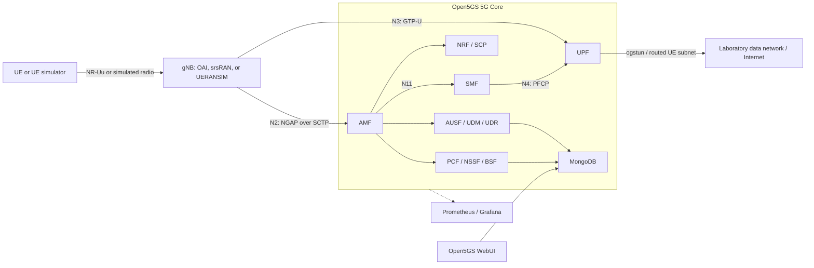

# OAI-5GC Raspberry Pi Port

This project provides an ARM64 environment for building and running Open5GS, OpenAirInterface (OAI), and related mobile-network components on Raspberry Pi devices.

The Open5GS container environment has been compiled and run successfully on a Raspberry Pi 5. The repository includes an Open5GS source snapshot, Docker build files, Compose deployment manifests, configuration templates, tests, and an auxiliary setup script for OAI and FlexRIC.

> This repository is intended for research, education, and controlled laboratory use. Review and secure all sample identities, credentials, addresses, and exposed ports before connecting the system to an untrusted network.

## Validation Status

- Raspberry Pi 5 ARM64 compilation: verified
- Open5GS container build: verified
- Open5GS runtime on Raspberry Pi 5: verified
- Docker Compose deployment: verified in a controlled test environment
- Open5GS WebUI: available for subscriber management

For reproducible testing, record the Raspberry Pi model, operating system, kernel, Docker version, repository commit, selected Compose manifest, local environment configuration, and built image digests.

## Repository Layout

```text
.
├── 00_oaisetup.sh                 # Auxiliary OAI and FlexRIC setup script
├── README.md
└── open5gs/
    ├── docker_open5gs/            # Images and Compose deployment manifests
    ├── docker/                     # Upstream Open5GS Docker resources
    ├── configs/                    # Open5GS configuration templates
    ├── src/                        # Open5GS source code
    ├── tests/                      # Open5GS tests
    └── webui/                      # Open5GS WebUI
```

The main deployment manifests are located in `open5gs/docker_open5gs/`:

| File | Purpose |
| --- | --- |
| `sa-deploy.yaml` | 5G standalone core network |
| `sa-vonr-deploy.yaml` | 5G standalone core with IMS/VoNR |
| `4g-volte-deploy.yaml` | 4G EPC with IMS/VoLTE |
| `4g-external-ims-deploy.yaml` | 4G EPC with an external IMS |
| `deploy-all.yaml` | Complete laboratory component set |
| `nr-gnb.yaml` / `nr-ue.yaml` | UERANSIM gNB and UE |
| `srsgnb*.yaml` / `srsue*.yaml` | srsRAN gNB and UE |
| `oaignb.yaml` / `oaienb.yaml` | OAI radio components |

## Architecture

The repository separates the radio access network, 5G core control plane,
user plane, subscriber data, and optional IMS services into containers. A
typical standalone deployment has the following data flow:



### Component Responsibilities

| Layer | Main components | Responsibility |
| --- | --- | --- |
| Radio access | OAI, srsRAN, UERANSIM | Provides a physical or simulated gNB and UE |
| Access and mobility | AMF | Terminates N2, handles registration and mobility |
| Session control | SMF | Creates PDU sessions and programs the UPF over N4 |
| User plane | UPF | Carries UE traffic between N3 and the data network |
| Authentication and data | AUSF, UDM, UDR, MongoDB | Stores subscriber data and performs authentication |
| Discovery and policy | NRF, SCP, PCF, NSSF, BSF | Service discovery, routing, policy, and slice selection |
| Operations | WebUI, Prometheus, Grafana | Subscriber administration, metrics, and dashboards |
| Optional voice services | HSS, P-CSCF, I-CSCF, S-CSCF, RTPengine, DNS | Supports IMS-based VoLTE or VoNR scenarios |

The Docker network uses static addresses from `TEST_NETWORK`. The AMF and UPF
must be reachable by the selected gNB. UE traffic is routed through the UPF TUN
interfaces using `UE_IPV4_INTERNET` and, when IMS is enabled, `UE_IPV4_IMS`.

## Installation Workflow

Use this order for a first 5G standalone deployment:

1. Prepare an ARM64 Raspberry Pi host and install Docker with Compose support.
2. Clone the repository and record the Git revision used for the test.
3. Review `open5gs/docker_open5gs/.env` and assign addresses for the local lab.
4. Build the Open5GS base image and the images required by the selected scenario.
5. Validate the Compose configuration before creating containers.
6. Start the core and confirm that its network functions remain running.
7. Add a test subscriber through the WebUI.
8. Start a gNB, confirm NG Setup, and then start the UE.
9. Verify registration, PDU-session creation, UE addressing, and data traffic.
10. Stop the scenario and retain the logs and version information for diagnosis.

The following sections provide the commands for each stage.

## Requirements

- Raspberry Pi 5, with 8 GB memory recommended
- A 64-bit Raspberry Pi OS or Ubuntu Server installation
- Docker with Compose support
- Sufficient storage for source builds and container images
- A trusted and isolated laboratory network
- TUN, SCTP, routing, and iptables support when required

Confirm that the host uses ARM64:

```bash
uname -m
```

Confirm that Docker and Compose are available:

```bash
docker version
docker compose version
```

## Install Docker

Install Docker using the method recommended for your operating system. Optionally add the current user to the Docker group:

```bash
sudo usermod -aG docker "$USER"
newgrp docker
```

Verify the installation:

```bash
docker run --rm hello-world
```

## Get the Source

```bash
git clone https://gitlab.com/limx59/oai-5gc-pi.git
cd oai-5gc-pi
```

Record the source revision:

```bash
git rev-parse HEAD
```

## Configure the Environment

Move to the deployment directory:

```bash
cd open5gs/docker_open5gs
```

Review `.env` before building or starting any service. Use environment-specific values rather than committing real addresses:

```dotenv
MCC=<MOBILE_COUNTRY_CODE>
MNC=<MOBILE_NETWORK_CODE>

TEST_NETWORK=<PRIVATE_CONTAINER_SUBNET>
DOCKER_HOST_IP=<RASPBERRY_PI_IP>

MONGO_IP=<MONGODB_CONTAINER_IP>
HSS_IP=<HSS_CONTAINER_IP>
SMF_IP=<SMF_CONTAINER_IP>
UPF_IP=<UPF_CONTAINER_IP>
AMF_IP=<AMF_CONTAINER_IP>
WEBUI_IP=<WEBUI_CONTAINER_IP>

UE_IPV4_INTERNET=<INTERNET_DATA_NETWORK_SUBNET>
UE_IPV4_IMS=<IMS_DATA_NETWORK_SUBNET>
```

Replace every angle-bracketed value with an address or identifier assigned to your local laboratory environment. The complete `.env` file contains additional component addresses that must be configured consistently.

- `MCC` and `MNC` must match the UE, gNB, SIM, and subscriber configuration.
- `DOCKER_HOST_IP` must be the Raspberry Pi address reachable from the laboratory network.
- `TEST_NETWORK` must not overlap with the host LAN, a VPN, or another Docker network.
- Component addresses must belong to the configured private container subnet.
- IMSI, KI, OP, and related authentication data must be reserved for testing.

Do not publish real subscriber credentials, private network addresses, production secrets, or host-specific routing information.

Validate variable substitution before building:

```bash
docker compose -f sa-deploy.yaml config --quiet
```

Resolve every warning about missing variables before continuing. A warning
about the legacy Compose `version` field does not block deployment, but the
field should be removed when the manifests are modernized.

## Build the Images

Build the Open5GS base image:

```bash
cd base
docker build --no-cache --force-rm -t docker_open5gs .
cd ..
```

Build additional images required by the selected scenario:

```bash
docker compose -f sa-deploy.yaml build
```

IMS, UERANSIM, srsRAN, and OAI scenarios require additional images. See:

```text
open5gs/docker_open5gs/README.md
```

## Start the 5G Standalone Core

Run the following commands from `open5gs/docker_open5gs/`:

```bash
docker compose -f sa-deploy.yaml up -d
```

Check service status:

```bash
docker compose -f sa-deploy.yaml ps
```

Wait until the core services are stable before starting a gNB. Containers that
continually restart usually indicate an address conflict, an unavailable
database, or an inconsistent `.env` value.

Inspect key network-function logs:

```bash
docker logs -f amf
docker logs -f smf
docker logs -f upf
```

Stop the deployment:

```bash
docker compose -f sa-deploy.yaml down
```

To remove the associated test database volume, first confirm that its data is no longer needed:

```bash
docker compose -f sa-deploy.yaml down -v
```

### Add a Test Subscriber

Open the WebUI described below and create a laboratory subscriber whose IMSI,
KI, OP or OPC, AMF, slice, and APN or DNN values match the UE configuration.
Never enter credentials belonging to a production subscriber.

At minimum, verify these values before starting the UE:

| Setting | Must match |
| --- | --- |
| MCC and MNC | Core, gNB, UE, and subscriber record |
| IMSI, KI, OP/OPC, AMF | UE or SIM and WebUI subscriber record |
| TAC | AMF and gNB |
| SST/SD | AMF, NSSF/SMF, gNB, and UE |
| APN/DNN | Subscriber record, SMF, and UE |

## Other Deployment Scenarios

Start 4G EPC with IMS/VoLTE:

```bash
docker compose -f 4g-volte-deploy.yaml up -d
```

Start 5G SA with IMS/VoNR:

```bash
docker compose -f sa-vonr-deploy.yaml up -d
```

Start a UERANSIM gNB:

```bash
docker compose -f nr-gnb.yaml up -d
docker attach nr_gnb
```

Start a UERANSIM UE:

```bash
docker compose -f nr-ue.yaml up -d
docker attach nr_ue
```

Start the core before the simulated gNB or UE. Confirm that the MCC, MNC, TAC, slices, DNN/APN, and subscriber authentication values match.

## WebUI and Monitoring

The default 5G SA deployment publishes these management services:

| Service | Default host port | Purpose |
| --- | ---: | --- |
| Open5GS WebUI | `9999` | Subscriber management |
| Grafana | `3000` | Dashboards |
| Prometheus | `9090` | Metrics |

Open the WebUI from a trusted machine:

```text
http://<RASPBERRY_PI_IP>:9999
```

`<RASPBERRY_PI_IP>` is a placeholder. Replace it locally with the Raspberry Pi address. Do not commit the actual address.

Before deployment:

- Set strong, unique `SECRET_KEY` and `JWT_SECRET_KEY` values
- Change default administrator and database credentials
- Restrict ports `9999`, `3000`, and `9090` to trusted hosts
- Place management interfaces behind an authenticated HTTPS reverse proxy
- Do not expose databases or monitoring services to public networks
- Review all additional control-plane, user-plane, radio, and IMS ports in the selected Compose manifest

## Prebuilt Images

ARM images tested by the project maintainer on Raspberry Pi 5 are available from:

```text
https://hub.docker.com/u/limx59
```

Example image pulls:

```bash
docker pull limx59/open5gs-amf:latest
docker pull limx59/open5gs-smf:latest
docker pull limx59/open5gs-upf:latest
docker pull limx59/open5gs-hss:latest
docker pull limx59/open5gs-pcrf:latest
docker pull limx59/open5gs-webui:latest
```

The included Compose manifests use local image names such as `docker_open5gs`. To use prebuilt images, update the applicable `image:` fields locally. Prefer immutable version tags or image digests over `latest`.

## Troubleshooting

List all containers:

```bash
docker ps -a
```

Inspect recent logs:

```bash
docker compose -f sa-deploy.yaml logs --tail=200
```

Inspect Docker networks:

```bash
docker network ls
docker network inspect docker_open5gs_default
```

Inspect host tunnel and routing state:

```bash
ls -l /dev/net/tun
ip addr
ip route
```

Common causes of deployment failure include:

- The private container subnet conflicts with a LAN, VPN, or another Docker network.
- `DOCKER_HOST_IP` does not match the Raspberry Pi.
- Radio, UE, subscriber, and core-network settings are inconsistent.
- SCTP or TUN support is missing.
- The UPF lacks required capabilities, devices, or host routes.
- The Raspberry Pi has insufficient memory or storage.
- A required host port is already in use.

When sharing logs, redact addresses, subscriber identifiers, authentication material, tokens, credentials, and host-specific routing data.

## Test Checklist

After each build:

1. Confirm that all required core-network containers remain healthy.
2. Confirm that the gNB completes NG Setup with the AMF.
3. Confirm that a test UE can register and authenticate.
4. Confirm that the SMF and UPF establish a PDU session.
5. Confirm that the UE receives connectivity to the intended test data network.
6. Restart the deployment and confirm that subscriber data persists.

## OAI and FlexRIC Setup Script

The root-level `00_oaisetup.sh` script assists with installing OAI radio components, the OAI core environment, and FlexRIC. It downloads external source code, installs system packages, and uses elevated privileges during some operations.

Review the script before running it:

```bash
bash 00_oaisetup.sh
```

The OAI and FlexRIC defaults follow their upstream development branches. For a
reproducible build, select known release tags or commit hashes explicitly:

```bash
OAI_REF=<OAI_TAG_OR_COMMIT> FLEXRIC_REF=<FLEXRIC_TAG_OR_COMMIT> bash 00_oaisetup.sh
```

If an existing `oai`, `swig`, or `flexric` checkout contains local changes, the
script stops instead of overwriting them.

The Open5GS Docker deployment does not depend on this script.

## Contributing

Contributions are welcome in the following areas:

- Raspberry Pi build and performance results
- ARM64 image optimization
- Reproducible Compose configurations
- Automated builds and smoke tests
- Secure default configuration
- Documentation and troubleshooting examples

Create a dedicated branch for each change:

```bash
git checkout -b feature/my-change
git commit -m "Describe the change"
git push origin feature/my-change
```

Do not commit private addresses, subscriber secrets, credentials, tokens, or other environment-specific sensitive data.

## License

The Open5GS source in this repository is provided under the GNU Affero General Public License version 3:

```text
open5gs/LICENSE
```

The Docker deployment resources contain their own license and third-party notices:

```text
open5gs/docker_open5gs/LICENSE
```

Before redistributing source code or container images, review the license requirements of Open5GS, OpenAirInterface, Kamailio, srsRAN, UERANSIM, FlexRIC, and all other bundled components.

## Acknowledgements

- [Open5GS](https://open5gs.org/)
- [OpenAirInterface](https://www.openairinterface.org/)
- [docker_open5gs](https://github.com/herlesupreeth/docker_open5gs)
- [srsRAN](https://www.srsran.com/)
- [UERANSIM](https://github.com/aligungr/UERANSIM)

## Contact

For questions and test feedback:

```text
limx59@163.com
```
