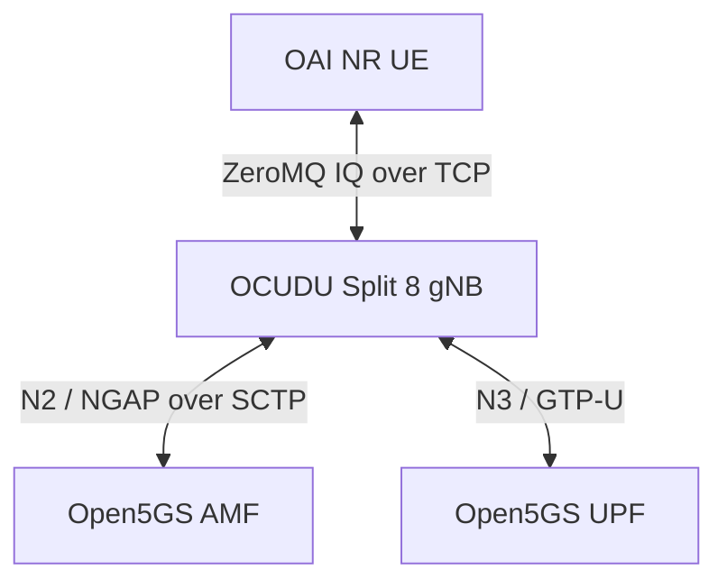
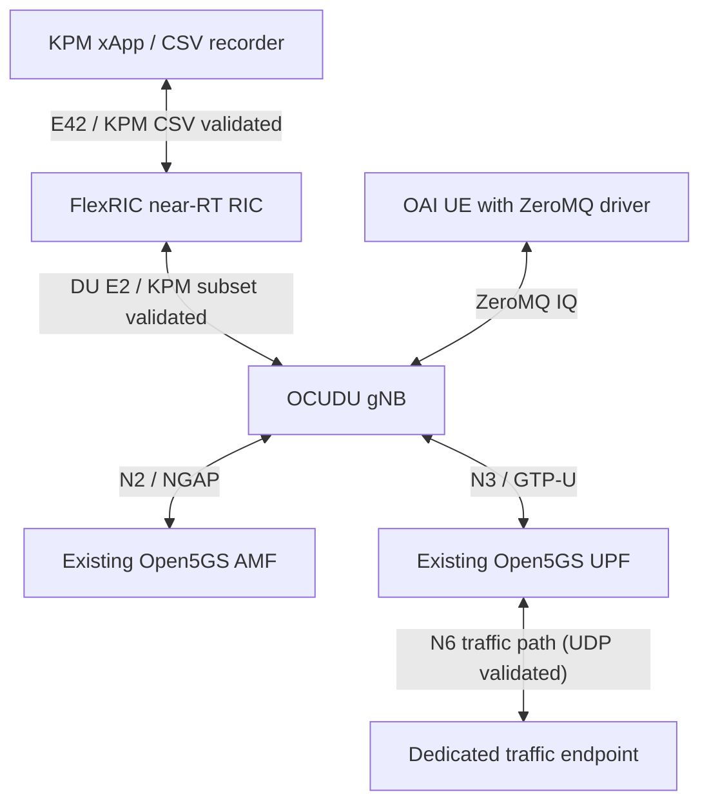

# OCUDU + OAI UE ZeroMQ integration on Raspberry Pi

## Validation status

Validated on a four-core Cortex-A76 ARM64 Raspberry Pi with approximately
8 GiB RAM. Results below include the documented tests completed through
2026-10-25, Pacific time.

The dedicated two-worker OCUDU image passed initial UE attachment and
TUN-bound UPF pings. Three subsequent rounds independently recreated both
experiment containers. Each round passed two sets of five UPF pings and
a 20-second interval with unchanged container process identities and UE
IPv4 address. All 30 regression ping requests received replies.
Both experiment services were stopped after every round.

UE addresses were 192.168.100.26, .27 and .28 across the three rounds.
Address preservation is checked within each round; allocation can change
between fresh sessions.

Separate UDP tests passed at 1 Mbps for 10 seconds per direction.
The documented DU E2/KPM and CSV subset passed single-round and
three-round tests. Subsequent tests validated one-second monitoring within
the documented timing thresholds, Style 1/4 UL/DL and idle response,
unsupported-metric rejection with same-xApp recovery, and delete rejection
with continued reporting, successful retry and post-delete silence.

Subscription rejection/recovery and delete rejection/retry each passed
three rounds. The bounded xApp container-kill cleanup scenario also
passed separate regressions.

QoS monitoring validated five DU KPM fields and units, directional
high/low-load alerts and recovery, and persistent supervisor state
across managed SDK sessions. Both QoS integration cases passed three
consecutive rounds. The host I/O readiness guard was checked separately.

The documented scheduler/RLC and CU-UP PDCP statistics cases each
passed three rounds. Independent reporting/statistics clocks and
PDCP batch progression were checked within the single-UE scope.

These results validate the documented software-radio scenarios.
Maximum throughput, long-term stability, complete E2 interoperability,
physical RF and OCUDU control capabilities remain outside the completed
validation scope.

## Architecture



Open5GS runs on the existing `docker_open5gs_default` network.
The connectivity-only experiment does not require a RIC or xApp.
The E2/KPM experiment adds both through compose.e2.yaml.

### Integrated DU KPM test topology

The bounded DU KPM tests extend the connectivity baseline with FlexRIC,
a KPM xApp / CSV recorder and a dedicated traffic endpoint.



The OAI UE / ZeroMQ / OCUDU / existing Open5GS path has passed bounded
connectivity checks. A dedicated traffic endpoint at 172.22.0.151 and
bounded UDP uplink/downlink tests have also passed. The DU FlexRIC
E2/KPM path, normal subscriptions, CSV recording and normal deletion
passed single-round and three fresh-container rounds. This covers only
the documented subset. An observed xApp disconnect cleanup crash was
addressed and the explicit container-kill scenario passed bounded
regression tests; full protocol compatibility is not established.

Start with one gNB and one UE. Run the original OAI RFsim baseline and
the OCUDU ZeroMQ scenario sequentially against the existing core, using
the same traffic definitions for later comparison. Do not run both full
RAN stacks concurrently on the four-core Pi without a resource assessment.
ZeroMQ is a software IQ transport and is not the OAI RFsim protocol.

| Component | Address / setting |
| --- | --- |
| AMF | 172.22.0.10:38412 |
| UPF | 172.22.0.8; UE gateway 192.168.100.1 |
| OCUDU gNB | 172.22.0.160; container CPU set 1-2 |
| OAI UE | 172.22.0.161; container CPU set 3 |
| Downlink IQ | gNB TCP 4558 |
| Uplink IQ | UE TCP 4556 |
| Cell | n78, 20 MHz, 51 PRB, 30 kHz SCS, PCI 1, 1T1R |
| Sample rate | 23.04 Msamples/s |
| Core identity | PLMN 00101, TAC 1, SST 1 |

CPU sets do not reserve exclusive host cores.

## Images and source policy

The passed Compose workflow now defaults to these Docker Hub images.
Both were published and pull-verified on 2026-10-14, Pacific time.
ARM64 architecture, original local image identity and registry digest
were verified.

| Component | Published image |
| --- | --- |
| OAI UE | `limx59/oai-pi-oai-nr-ue:arm64-zmq-test` |
| OCUDU two-worker gNB | `limx59/oai-pi-ocudu-gnb:arm64-zmq-worker-test` |

Published image-index digests:

- OAI UE: `sha256:73fa22bcb85f2c040a398d0c3159a7a9083e7dee7db23a7c6fe7e3c26d2110e8`
- OCUDU gNB: `sha256:1733f139f5e1001ca0c146f8b51e017d9fe71b0c07616beff233b468be8cc608`

Original local tags are retained. The base Compose file's gNB image,
`oai-pi-ocudu-gnb:zmq-test`, is the original diagnostic baseline.
Always include `compose.zmq-worker-test.yaml` for the passed workflow.

Three-round functional regressions passed using both the original local
tags and the updated published Compose references. The published-reference
regression passed all 30 ping requests, process/address stability checks
and automatic stopping across three fresh-container rounds.

OCUDU source revision and license location:
[upstream record](../../docker/ocudu/UPSTREAM.md).

Project Dockerfiles and patches operate on Docker source copies.
The vendored `ocudu/` and existing `oai/` source trees remain unchanged
by this integration work.

## Single-worker failure and diagnostic workaround

The original image connected to AMF and activated cell scheduling, but
the UE failed initial synchronization. An independent ZeroMQ probe
received all-zero downlink IQ over one second of samples. In a separate
actual-UE debug run, all 2365 FAPI records were slot indications, with
no recorded downlink requests.

The upstream worker-count calculation reserves up to three available
CPUs and clamps even explicitly configured counts. On this Pi it produced
one main-pool worker. Non-real-time cell executors also use synchronous
task wrappers.

`Dockerfile.worker-test` changes only the Docker source copy to honor
an explicit worker count within the available CPU count. The deployment
override requests two workers. This configuration produced downlink
FAPI requests, successful PBCH decoding, a PDU session and passing pings.

The comparison strongly implicates the single-worker execution path.
A precise blocked call stack and a general upstream fix have not been
established. This remains a diagnostic workaround, not an upstream fix.

## Prerequisites

- Existing Open5GS services and network running.
- Experiment addresses .160 and .161 available.
- Matching subscriber credentials provisioned in Open5GS.
- Private UE configuration at `deploy/ocudu/.local/ue-zmq.conf`.
  Keep it untracked; `.local/` is ignored. Use directory mode 0700 and
  file mode 0600.
- UE configuration retains the provisioned UICC/PDU-session settings,
  removes the RFsim section and selects `oai_zmqdevif`, with TX endpoint
  `tcp://0.0.0.0:4556` and RX endpoint `tcp://172.22.0.160:4558`.
- `/dev/net/tun` and the OAI single-port UE capability XML available.
- No experiment containers already running before invoking the validator.

Do not commit subscriber keys or private generated configuration.

## Build

Optional local rebuild commands follow. They retain local tags and do not
replace the published Compose defaults. To use locally rebuilt images,
supply an explicit Compose image override.

Run from the project root:

```bash
sudo docker build -f docker/oai/Dockerfile.nrue-zmq \
  --target nrue --build-arg BUILD_JOBS=2 \
  -t oai-pi-oai-nr-ue:zmq-test .

sudo docker build -f docker/ocudu/Dockerfile.worker-test \
  --target gnb --build-arg BUILD_JOBS=2 \
  -t oai-pi-ocudu-gnb:zmq-worker-test .
```

The OCUDU build uses `cortex-a76+crypto` and an ARMv8.2-A fallback.
The worker test Dockerfile reuses the baseline builder stages when cached.

## Test Case: Node discovery

Verify that the OCUDU gNB joins Open5GS and exposes the expected DU
identity through FlexRIC, so an xApp can select the intended E2 node.

### Source revision and Open5GS NG Setup

**Status: Passed for the documented software-radio configuration.**

Use the recorded OCUDU revision and the two-worker configuration to
establish NG Setup, UE attachment and a working user-plane path.
The connectivity regression passed 30 of 30 UPF pings over three rounds.

**Test guide:** [Deployment and configuration](../../deploy/ocudu/README.md).
See also the connectivity procedure under Integrated regression below.

### DU E2 Setup and xApp discovery

**Status: Passed for the documented DU configuration.**

Verify E2 Setup, discovery of node 420 with DU ID 0, and the advertised
KPM RAN function before subscribing.

**Test guide:** [DU E2/KPM setup and validation](README.zmq-kpm.md).

**Remaining:** CU Agent identity coverage, RIC/Agent reconnection and
abnormal-exit cleanup beyond the completed xApp-disconnection scenario.

## Test Case: KPM monitoring

Verify KPM subscriptions, periodic indications, traffic and idle response,
and recovery from the selected subscription failures.

### Normal subscription and reporting

**Status: Passed.**

Verify the DU subscription path, action Format 4, indication Format 3,
normal reporting and subscription deletion.

**Test guide:** [DU KPM configuration and normal-flow validation](README.zmq-kpm.md).

### One-second monitoring

**Status: Passed within the documented timing thresholds.**

Check report timing using the collection-clock configuration, including
independent measurement collection and report-generation behavior.

**Test guide:** [One-second DU KPM monitoring](README.kpm-one-second.md).

### Report styles, UL/DL and idle response, and abnormal subscription handling

**Status: Completed for the agreed Style 1/4 test scope.**

Verify Style 1 and Style 4 under separate uplink and downlink UDP loads
and during idle periods. Check one-second reporting, directional load
response and idle values. Verify unsupported-metric rejection followed
by normal subscription recovery in the same xApp.

Also verify that a rejected deletion preserves reporting, a retry on the
same subscription succeeds, and both sender and callback remain silent
after the deletion grace period. Subscription rejection/recovery and
delete rejection/retry each passed three rounds.

**Test guides:**

- [Timing configuration and monitoring procedure](README.kpm-one-second.md)
- [Traffic, CSV and normal deletion checks](README.zmq-kpm.md)
- [Unsupported-metric rejection and same-xApp recovery](README.kpm-subscription-rejection.md)
- [Delete rejection, continued reporting, retry and post-delete silence](README.kpm-delete-rejection.md)

The completed scope covers these report styles and rejection scenarios.
Additional protocol-fault scenarios are outside this item's acceptance
scope.

### Abrupt xApp disconnection

**Status: Passed for the bounded container-kill scenario.**

Terminate the xApp container, check RIC cleanup, then verify that a new
xApp can subscribe. Local and published-image regressions passed.

**Test guide:** [Abrupt xApp disconnection](README.zmq-kpm-disconnect.md).

### OCUDU E2 build configuration and FlexRIC compatibility

**Status: Completed for the documented DU KPM subset.**

Verify the actual ARM64 builder cache and configured gNB E2 link
dependencies, then exercise the current patched runtime image combination.
Record the differing protocol declarations and the tested scope.

**Test guide:** [Build configuration and compatibility validation](README.e2-kpm-compatibility.md).

The current KPM monitoring acceptance scope is complete. This does not
establish full E2 protocol conformance or untested control capabilities.

## Test Case: KPM CSV recording

Verify that the recorder produces usable, attributable KPM rows and
retains the evidence needed to interpret traffic experiments.

### Node identity, receive timestamps and numeric rows

**Status: Passed for the documented fields.**

Check node/PLMN identity, UTC receive timestamps, finite numeric values,
row counts and missing records.

**Test guide:** [CSV fields and acceptance checks](README.zmq-kpm.md).

### Directional load response and deletion cleanup

**Status: Passed.**

Verify positive values under the corresponding UL/DL UDP load and check
normal subscription deletion. Single-round and three-round regressions
passed.

**Test guide:** [Traffic-backed CSV recording and cleanup](README.zmq-kpm.md).

### UE identity, collection windows, units and traffic comparison

**Status: Passed for the documented single-UE configuration.**

Record DU node identity and the UE's CU-F1AP identifier, collection-header
timestamps, granularity, nominal row windows and throughput units.
Compare UL/DL KPM rates with application receiver rates under bounded
UDP traffic. Correlate the CSV UE identifier with independent gNB F1
context and C-RNTI logs.

The baseline metadata test and the separate identity-correlation test
both passed. Nominal protocol windows are not exact RLC sample boundaries.

**Test guide:** [CSV metadata, UE identity and UL/DL comparison](README.kpm-csv-metadata.md).

## Test Case: QoS monitoring

Map available DU KPM measurements into throughput, RLC delay and SDU
drop observations, then exercise advisory alerts and session recovery.

### Fields, load alerts and managed-session recovery

**Status: Passed for the documented single-UE advisory scope.**

Validate five DU KPM fields and their units, preserve unavailable values,
and check UL/DL high/low/high traffic alerts and recovery.
Keep supervisor state alive across two managed SDK sessions; verify
silence detection, session reset, rejection of replayed old-generation
input and fresh consecutive-report counters.

Both integration cases passed three consecutive rounds, six runs total.
The regression entry point also includes a bounded host I/O readiness
guard, validated separately with read-only and offline checks.

RLC delay/drop are not end-to-end latency/loss. Low offered load and
idle can trigger alerts. Recovery uses SDK process replacement, not
same-process automatic reconnection or RIC/Agent restart.
Live delay/drop fault injection is outside this validation scope.

**Test guide:** [QoS fields, alerts, session recovery and regression](README.qos-monitor.md).

**Baseline documentation:** [Existing FlexRIC test documentation](../flexric/README.md).

## Test Case: MAC / RLC / PDCP statistics

Establish the source and meaning of measurements before using them for
comparison or policy decisions.

### DU scheduler/RLC fields and CU-UP PDCP statistics clocks

**Status: Passed for the documented single-UE subset; broader scope remains open.**

Validate ten DU scheduler PRB and RLC fields, units, exported CSV
integrity and bounded UL/DL comparison with application receiver rates.
Validate CU-UP node-level PDCP packet-success delivery, independent
report/statistics clocks and matched, consecutive aggregator batches.

Both integration cases passed three consecutive rounds, six runs total.
Existing TX/RX metrics suites and four added C++ timer-isolation tests
passed. The final PDCP gNB image was published and pull-verified.
The optional Compose overlay passed merge checks; integration tests used
their generated overrides and a temporary RIC.

PRB arithmetic is not independent scheduler accuracy. PDCP success is
not application packet loss. Batch progression does not establish
one-to-one KPM/source correlation or counter-reset handling.

**Test guides:**

- [Statistics fields, clocks, regression and limitations](README.radio-stats.md)
- [PDCP batch history and calculation provenance](README.pdcp-batch-history.md)
- [DU KPM measurements](README.zmq-kpm.md)
- [Collection clock and one-second monitoring](README.kpm-one-second.md)

PDCP follow-up validation passed nineteen C++ history/provider tests,
nine retained-evidence reviewer checks and three integration rounds.
The opt-in path filters by provider receipt age and traces the batches
used for each calculation. CSV association uses unique timestamps and
values; no provider query ID is carried in the KPM report.
The three follow-up images were published and pull-verified.
Build and test execution are separate.

**Completed extension:** Controlled duplicate/missing/reset detection,
live source reconstruction and one late-old-source rejection, with
post-reset KPM calculation checks (single UE/bearer).

**Remaining:** Stronger on-wire source/report identification,
broader MAC/RLC freshness checks, independent scheduler accuracy,
PDCP reordering-delay delivery, multi-UE/bearer integration and broader
xApp compatibility.

### xApp compatibility

**Status: Completed within the documented single-node compatibility scope; unsupported custom models explicitly recorded.**

Reuse the unchanged shared KPM recorder with OCUDU DU Format 3 reports.
The dedicated published xApp image and Compose service passed UL/DL
traffic checks: 40 reports, 80 CSV rows, no callback or cleanup errors.
Probe and CSV report counts agree; the baseline RIC was retained.

A separate CU-UP Style 1 / Format 1 joint test passed with the same
published image: 40 reports, 19 complete numeric rows and 21 no-value
rows; UL median success was 100 percent. Cleanup succeeded.

The recorder tests use a dedicated subscription harness. Separately,
the unchanged original shared KPM demo main passed the DU normal flow:
ten reports, normal deletion and successful cleanup, with packaged
script bytes checked against source.

The original CU-UP demo main also passed a separate normal-flow test:
nine reports, eight numeric PDCP samples, normal deletion and cleanup.
The original script matched source; the published image was reused.

The unchanged shared QoS xApp also passed four dedicated image/Compose
joint scenarios: UL/DL forced alerts and no-alert controls, with active
traffic, correct two-report alert timing and successful cleanup.

The DU custom MAC/RLC/PDCP capability boundary was also audited:
SDK discovery and RIC acceptance show KPM ID 2 only; custom IDs
142/143/144 were not advertised. No subscriptions were attempted.
This establishes an unsupported boundary, not custom-SM data delivery.

CU-UP capability auditing also passed with KPM ID 2 only and no custom
subscriptions. The defined compatibility scope is complete: supported
KPM paths were exercised and unsupported custom models documented.
This does not establish custom-SM delivery or full E2 conformance.
Original-demo failure paths, reconnect and real QoS degradation/recovery
remain outside the completed scope.

**Test guides:**

- [xApp compatibility](README.xapp-compatibility.md)
- [CU-UP shared-recorder compatibility](README.xapp-compatibility-cuup.md)
- [Original shared KPM demo main](README.xapp-demo-main.md)
- [Shared QoS xApp compatibility](README.xapp-qos-compatibility.md)
- [Custom service-model capability boundary](README.xapp-custom-sm-capability.md)

## Test Case: Traffic steering policy

Evaluate recommendations using comparable load measurements, consistent
rules and cooldown behavior before attempting live control.

### Reusable load-exchange and rule-evaluation baseline

**Status: Existing OAI/FlexRIC baseline available for reuse.**

Reuse the existing evaluation method after verifying the OCUDU metric
mapping. The controlled FlexRIC emulator baseline is separate from
actual OAI radio-load validation. OCUDU single-link load response
subsequently passed the independent joint test below.

**Baseline documentation:** [Existing FlexRIC test documentation](../flexric/README.md).

### Single-link load response

**Status: Passed for the documented single-DU/UE subset.**

The dedicated published image, Compose service and independent validator
passed six UL/DL low-high-low traffic phases. The unchanged collector
recorded 110 reports and 1100 CSV rows. All phases had zero receiver loss;
KPM/iperf ratios were 1.031 to 1.044. Cleanup succeeded and the baseline
RIC was retained. No migration recommendation or E2 control was performed.

**Test guide:** [Single-link load response](README.steering-load-response.md).

### Sequential OAI/OCUDU comparison

**Status: Passed for the documented separate single-UE runs.**

The independent wrapper ran OAI RFSim first, completed cleanup, then ran
OCUDU ZeroMQ. Both sides passed six identical offered-load phases.
The published OAI collector image and dedicated Compose service were
exercised together. Both CSV files were independently reviewed and the
baseline RIC identity remained unchanged across the sequential runs.

KPM/iperf ratios were 1.038 to 1.148 for OAI and 1.028 to 1.047 for OCUDU.
OAI uses receipt-time association; OCUDU uses nominal KPM windows.
PRB values retain their respective implementation semantics. This case
does not establish equivalent radio capacity or generate steering control.

**Test guide:** [Sequential OAI/OCUDU comparison](README.steering-sequential-comparison.md).

### Common metrics and cooldown rules

**Status: Passed for retained throughput mapping and controlled policy fixtures.**

The dedicated image and Compose validator converted 220 OAI and 220 OCUDU
throughput rows to bit/s while preserving source and time semantics.
The unchanged shared policy passed consecutive-observation, directional
reversal, eligibility and 30-second cooldown boundary checks.
Input hashes, packaged policy equality and container cleanup passed.

Converted throughput is not normalized cell utilization. Controlled
normalized-load fixtures exercise policy rules separately; PRB values
are not mapped across implementations. No live dual-node recommendation
or E2 control is established by this acceptance.

**Test guide:** [Common metrics and cooldown rules](README.steering-common-metrics.md).

### Dual-node asynchronous recommendations

**Status: Passed for the documented same-host embedded advisory scope.**

Local and digest-pinned published runtime images passed online recommendations
in both directions. Source-batch deduplication, receipt-age checks, two
consecutive independent pairs and cooldown were verified. No control was
executed; synchronized collection-window alignment remains unvalidated.

**Test guide:** [Embedded dual-node online advisory](README.steering-embedded-online.md).


## Test Case: Traffic steering control

Determine which OCUDU RC actions are supported and distinguish a control
acknowledgement from evidence of actual execution.

### Existing OAI RFsim handover feedback loop

**Status: Passed as an OAI baseline only.**

The existing OAI feedback-loop result provides a comparison point.
OCUDU control capability and execution have not yet been established.

**Baseline documentation:** [Existing FlexRIC test documentation](../flexric/README.md).

**Remaining:** OCUDU RC capability audit and separate ACK/execution
validation. Cross-vendor handover remains exploratory.
An OCUDU-specific execution guide is planned.

## Test Case: Multi-Agent slicing control

Determine the available slice configuration and control interfaces,
then collect scheduler evidence for any supported experiment.

### Existing OAI NR DL scheduler PRB-cap simulation

**Status: Passed as a standalone OAI simulation baseline only.**

The simulation validates the existing PRB-cap experiment, without
establishing OCUDU runtime slicing support.

**Baseline documentation:** [Existing FlexRIC test documentation](../flexric/README.md).

**Remaining:** OCUDU configuration/interface audit, offline or startup
configuration experiments, and actual grant/counter evidence. Verify
support before reusing private SLICE commands.
An OCUDU-specific execution guide is planned.

## Test Case: Energy-saving control

Evaluate energy-saving recommendations and simulated state feedback
before any physical-device experiment.

### Reusable policy and state-feedback simulation

**Status: Existing simulation framework available for reuse.**

Use the existing policy/state model as a baseline for future OCUDU
advisory-mode and simulated-state checks.

**Baseline documentation:** [Existing FlexRIC test documentation](../flexric/README.md).

**Remaining:** OCUDU advisory-mode and state-simulation validation.
Physical-device control and power measurement are deferred pending
hardware. An OCUDU-specific execution guide is planned.

## Test Case: Integrated regression

### Open5GS AUSF routing and real UE acceptance

The AUSF-local stale NF reference patch passed isolated original/patched
routing regression and real single-UE session/TUN-bound UPF checks.
Cleanup and baseline core continuity passed. Actual NRF heartbeat-loss
recovery remains unvalidated.

**Test guide:** [AUSF routing and real UE validation](../open5gs/README.ausf-stale-nf-reference.md).

Verify repeatable operation of the documented software-radio workflow,
retain failed and successful evidence, and distinguish bounded checks
from sustained-session validation.

### ARM64 builds and published images

**Status: Images used by the completed tests were built and published.**

Use the image tags specified by each guide. The three delete-rejection
test images were pushed and successfully pulled by tag. Source patches
are applied to isolated build copies.

**Test guides:**

- [Deployment and baseline images](../../deploy/ocudu/README.md)
- [Subscription-rejection images and build steps](README.kpm-subscription-rejection.md)
- [Delete-rejection images and build steps](README.kpm-delete-rejection.md)

### ZeroMQ connectivity regression

**Status: Three-round regression passed.**

Recreate the experimental RAN, verify UE attachment, run TUN-bound UPF
pings and check process/address stability within each round.
All 30 regression pings received replies.

**Procedure:** See [Run validation](#run-validation) below.
**Deployment guide:** [ZeroMQ setup](../../deploy/ocudu/README.md).

### Bounded UDP uplink/downlink regression

**Status: Passed for the documented offered load and duration.**

Exercise UL and DL independently and retain receiver-side throughput,
packet-loss results and iperf JSON. The initial acceptance thresholds
are at least 80% of offered throughput and no more than 5% packet loss.

**Test guide:** [Bounded UDP uplink/downlink validation](README.zmq-udp.md).

### KPM normal-flow, timing and failure-recovery regression

**Status: Documented bounded scenarios passed.**

Cover KPM/CSV normal operation, one-second monitoring, xApp container-kill
cleanup, unsupported-metric rejection/recovery, and delete rejection/retry
with post-delete silence.

**Test guides:**

- [KPM/CSV normal-flow regression](README.zmq-kpm.md)
- [One-second monitoring](README.kpm-one-second.md)
- [xApp disconnection regression](README.zmq-kpm-disconnect.md)
- [Subscription rejection and recovery](README.kpm-subscription-rejection.md)
- [Delete rejection and retry](README.kpm-delete-rejection.md)

### Patch replay and reproducibility records

**Status: Patch scripts, source snapshots, diffs and manifests retained.**

The subscription and deletion work was committed in `aaf54ec9` and
`e7fe2c57`. The archives preserve the documented patch order and original
and patched source copies.

**Archive documentation:**

- [Subscription-failure source snapshots](patches/flexric-subscription-failures/README.md)
- [Delete-rejection source snapshots](patches/kpm-delete-rejection/README.md)

The V3 failure-encoding archive is stored in
`patches/flexric-v3-failure-encoding/`.

**Remaining:** Testmode verification, sustained-session and long-term
stability, single-worker root cause and complete integrated-workflow
regression. Physical RF validation is deferred pending SDR hardware.

## Run validation

Run from the project root. The validator starts the experiment itself;
do not separately start the containers first.

```bash
python3 test/ocudu/validate-zmq-connectivity.py \
  --rounds 1 --output-dir /tmp/ocudu-zmq-connectivity \
  </dev/null
```

Repeatability check:

```bash
python3 test/ocudu/validate-zmq-connectivity.py \
  --rounds 3 --output-dir /tmp/ocudu-zmq-connectivity-regression \
  </dev/null
```

Each round force-recreates gNB and UE, waits up to 60 seconds for the TUN
IPv4 address, pings 192.168.100.1 through `oaitun_ue1`, waits 20 seconds,
checks process/address stability and repeats the pings. It saves filtered
logs and `summary.json`, then stops both services. Failure stops the
regression and retains evidence.

## Cleanup

The validator stops containers but retains them for inspection.
To remove this experiment's containers after evidence collection:

```bash
sudo docker compose \
  -f deploy/ocudu/compose.zmq.yaml \
  -f deploy/ocudu/compose.zmq-worker-test.yaml \
  --profile ue down
```

Check for remaining experiment and IQ-probe containers:

```bash
sudo docker ps -a --format '{{.Names}}' |
  awk '/^oai-pi-ocudu-zmq-lab-/ || /^ocudu-iq-probe-/'
```

For an E2 experiment, follow the cleanup instructions in
[the KPM guide](README.zmq-kpm.md), including the E2 Compose overlay,
before expecting an empty result.

Expected output is empty. Review any leftover probe by name before removing
it. Do not prune unrelated containers, images, networks or volumes.
The shared external Open5GS network and other services are retained.
Restart both ZMQ endpoints together when repeating the experiment.

## Evidence

Initial successful comparison and connectivity archive:

`ocudu-oai-zmq-initial-connectivity-20261014-220909.tar.gz`

Three-round regression:

- Directory: `/tmp/ocudu-zmq-connectivity-regression/run-5px273zy`
- Archive: `ocudu-oai-zmq-connectivity-regression-20261014-221433.tar.gz`

Published-reference three-round regression:

- Directory: `/tmp/ocudu-zmq-dockerhub-connectivity-regression/run-ewtyewbz`
- Archive: `ocudu-oai-zmq-dockerhub-connectivity-regression-20261014-223545.tar.gz`
- UE addresses: 192.168.100.29, .30 and .31 across the three rounds.

DU KPM/CSV single-round, three-round and interrupted-run evidence:

`ocudu-kpm-csv-20261015-214428.tar.gz`

See [DU KPM and CSV validation](README.zmq-kpm.md) for results and limitations.

Docker Hub reference DU KPM/CSV three-round regression passed on
2026-10-16, Pacific time: six directional phases, zero packet loss,
116 CSV rows and normal deletion/cleanup checks passed.

- Directory: `/tmp/ocudu-zmq-dockerhub-kpm-regression/run-jrzfzyab`
- Archive: `ocudu-dockerhub-kpm-regression-20261016-104059.tar.gz`
- Published RIC/xApp references and digests: [KPM guide](README.zmq-kpm.md).

KPM monitoring container-kill scenario: local single/three-round and
published-reference three-round tests passed. Verified archive:

`ocudu-kpm-disconnect-20261016-114442.tar.gz`

See [scenario details](README.zmq-kpm-disconnect.md).

Archives reside under `~/Work/oai-test-evidence/`, outside the repository.
Retain failed-run evidence as well as passed results.

## TODO

Existing OAI/FlexRIC results remain reusable baselines. OCUDU results
are recorded separately. Completed entries refer to the documented scope.

| Test case | Completed | Remaining |
| --- | --- | --- |
| Node discovery | ✅ Recorded OCUDU source revision; Open5GS NG Setup; DU E2 Setup | ☐ DU/CU Agent identity distinction; RIC/Agent reconnection; exit cleanup |
| KPM monitoring | ✅ Normal subscription and reporting; one-second monitoring; **report styles, UL/DL and idle response, and abnormal subscription handling completed within the agreed Style 1/4 scope**; bounded xApp-disconnection cleanup; E2 build-configuration and FlexRIC compatibility audit | — |
| KPM CSV recording | ✅ Node/PLMN, receive timestamps, numeric checks, row-count/missing-record checks, positive load response and subscription deletion; single-UE F1AP identity correlation; collection timestamps and nominal windows; measurement units; bounded quantitative UL/DL traffic comparison | — |
| QoS monitoring | ✅ Five DU KPM fields and units; UL/DL high/low-load alerts and recovery; advisory mode; persistent supervisor state across managed SDK sessions; three-round regression; separately checked host I/O readiness guard | — Completed within the documented single-UE advisory scope |
| MAC / RLC / PDCP statistics | ✅ DU PRB/RLC fields, units, CSV integrity and bounded UL/DL comparison; CU-UP PDCP delivery and clocks; C++ timer isolation; PDCP per-source history and receipt-age filtering; calculation provenance and temporal/value CSV association; unit and three-round integration checks; controlled duplicate/missing/reset detection and late-old-source rejection (single UE/bearer); DU and CU-UP shared-recorder xApp compatibility through the published image and separate Compose joint tests; original shared KPM demo DU/CU-UP normal-flow validation; shared QoS xApp UL/DL forced-alert and no-alert compatibility; DU/CU-UP custom MAC/RLC/PDCP unsupported-capability boundary audits (no subscriptions or delivery validation); xApp compatibility completed within the documented KPM/unsupported-custom-SM boundary | - |
| Traffic steering policy | ✅ Existing load-exchange and rule-evaluation methods available for reuse; OCUDU single-link UL/DL low-high-low load response through the published image and Compose joint test; sequential OAI/OCUDU comparison with separate six-phase runs, independent CSV review and baseline RIC continuity checks; common throughput mapping and unchanged-policy cooldown rules through packaged retained-evidence/controlled-fixture acceptance; same-host embedded dual-node asynchronous online recommendations in both directions using digest-pinned published images | — Completed within the documented embedded advisory scope |
| Traffic steering control | ✅ Existing OAI RFsim handover feedback-loop baseline passed | ☐ OCUDU RC capability audit; separate ACK and execution checks; exploratory cross-vendor handover |
| Multi-Agent slicing control | ✅ Existing OAI NR DL scheduler PRB-cap simulation baseline passed | ☐ OCUDU slice configuration and interface audit; offline/startup experiments; actual grant/counter evidence |
| Energy-saving control | ✅ Existing policy and state-feedback simulation available for reuse | ☐ OCUDU advisory mode and state simulation; **physical control and power measurement deferred pending hardware** |
| Integrated regression | ✅ ARM64 builds and published images; bounded connectivity, UDP, KPM/CSV, timing and selected failure-recovery regressions; Open5GS AUSF stale-reference routing regression and patched real-UE session/UPF acceptance; patch snapshots and documentation | ☐ Testmode verification; sustained-session and long-term stability; single-worker root cause; complete workflow regression; **physical RF deferred pending hardware** |

Execution follows the research plan: bounded traffic validation (P5) and
the documented DU KPM/CSV subset of P6 passed their respective tests.
The report-style, UL/DL, idle-response and abnormal-subscription-handling
item is complete within the agreed Style 1/4 and rejection/recovery scope.

Full-workflow regression (P7), sequential OAI/OCUDU comparison (P8),
and capability-gated RC/slicing experiments (P9) follow.

For P5, retain iperf JSON and receiver-side results. The initial project
acceptance thresholds are received throughput of at least 80% of the
offered load and packet loss no greater than 5%. Record failures without
silently relaxing these thresholds.

Track sustained-session rounds and fresh-container rounds separately.
Retain failed-run evidence as well as successful results.
