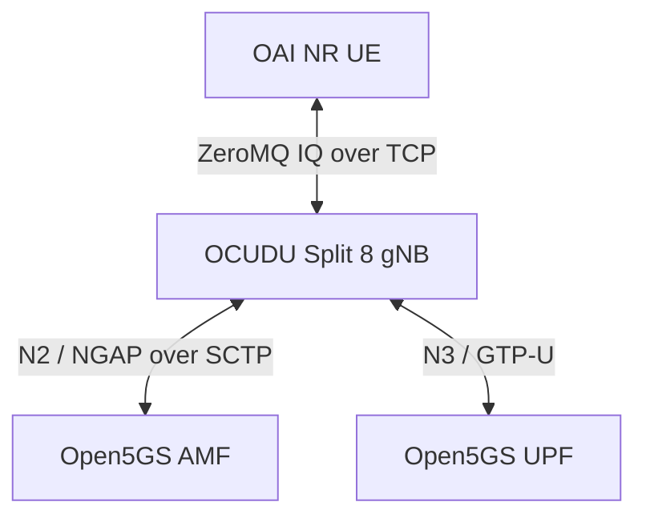

# OCUDU + OAI UE ZeroMQ integration on Raspberry Pi

## Validation status

Validated on a four-core Cortex-A76 ARM64 Raspberry Pi with approximately
8 GiB RAM on 2026-10-14, Pacific time.

The dedicated two-worker OCUDU image passed initial UE attachment and
TUN-bound UPF pings. Three subsequent rounds independently recreated both
experiment containers. Each round passed two sets of five UPF pings and
a 20-second interval with unchanged container process identities and UE
IPv4 address. All 30 regression ping requests received replies.
Both experiment services were stopped after every round.

UE addresses were 192.168.100.26, .27 and .28 across the three rounds.
Address preservation is checked within each round; allocation can change
between fresh sessions.

This validates bounded software-radio connectivity. Throughput, long-term
stability, physical RF, E2/FlexRIC interoperability and AI control remain
unvalidated.

## Architecture



Open5GS runs on the existing `docker_open5gs_default` network.
The experiment does not require a RIC or xApp.

| Component | Address / setting |
| --- | --- |
| AMF | 172.22.0.10:38412 |
| UPF | 172.22.0.8; UE gateway 192.168.100.1 |
| OCUDU gNB | 172.22.0.160; container CPU set 1-2 |
| OAI UE | 172.22.0.161; container CPU set 3 |
| Downlink IQ | gNB TCP 4558 |
| Uplink IQ | UE TCP 4556 |
| Cell | n78, 20 MHz, 51 PRB, 30 kHz SCS, PCI 1, 1T1R |
| Sample rate | 23.04 Msamples/s |
| Core identity | PLMN 00101, TAC 1, SST 1 |

CPU sets do not reserve exclusive host cores.

## Images and source policy

These are local ARM64 experiment images, not published Docker Hub images:

- `oai-pi-oai-nr-ue:zmq-test`
- `oai-pi-ocudu-gnb:zmq-test` — original diagnostic baseline
- `oai-pi-ocudu-gnb:zmq-worker-test` — passed two-worker configuration

OCUDU source revision and license location:
[upstream record](../../docker/ocudu/UPSTREAM.md).

Project Dockerfiles and patches operate on Docker source copies.
The vendored `ocudu/` and existing `oai/` source trees remain unchanged
by this integration work.

## Single-worker failure and diagnostic workaround

The original image connected to AMF and activated cell scheduling, but
the UE failed initial synchronization. An independent ZeroMQ probe
received all-zero downlink IQ over one second of samples. In a separate
actual-UE debug run, all 2365 FAPI records were slot indications, with
no recorded downlink requests.

The upstream worker-count calculation reserves up to three available
CPUs and clamps even explicitly configured counts. On this Pi it produced
one main-pool worker. Non-real-time cell executors also use synchronous
task wrappers.

`Dockerfile.worker-test` changes only the Docker source copy to honor
an explicit worker count within the available CPU count. The deployment
override requests two workers. This configuration produced downlink
FAPI requests, successful PBCH decoding, a PDU session and passing pings.

The comparison strongly implicates the single-worker execution path.
A precise blocked call stack and a general upstream fix have not been
established. This remains a diagnostic workaround, not an upstream fix.

## Prerequisites

- Existing Open5GS services and network running.
- Experiment addresses .160 and .161 available.
- Matching subscriber credentials provisioned in Open5GS.
- Private UE configuration at `deploy/ocudu/.local/ue-zmq.conf`.
  Keep it untracked; `.local/` is ignored. Use directory mode 0700 and
  file mode 0600.
- UE configuration retains the provisioned UICC/PDU-session settings,
  removes the RFsim section and selects `oai_zmqdevif`, with TX endpoint
  `tcp://0.0.0.0:4556` and RX endpoint `tcp://172.22.0.160:4558`.
- `/dev/net/tun` and the OAI single-port UE capability XML available.
- No experiment containers already running before invoking the validator.

Do not commit subscriber keys or private generated configuration.

## Build

Run from the project root:

```bash
sudo docker build -f docker/oai/Dockerfile.nrue-zmq \
  --target nrue --build-arg BUILD_JOBS=2 \
  -t oai-pi-oai-nr-ue:zmq-test .

sudo docker build -f docker/ocudu/Dockerfile.worker-test \
  --target gnb --build-arg BUILD_JOBS=2 \
  -t oai-pi-ocudu-gnb:zmq-worker-test .
```

The OCUDU build uses `cortex-a76+crypto` and an ARMv8.2-A fallback.
The worker test Dockerfile reuses the baseline builder stages when cached.

## Run validation

Run from the project root. The validator starts the experiment itself;
do not separately start the containers first.

```bash
python3 test/ocudu/validate-zmq-connectivity.py \
  --rounds 1 --output-dir /tmp/ocudu-zmq-connectivity \
  </dev/null
```

Repeatability check:

```bash
python3 test/ocudu/validate-zmq-connectivity.py \
  --rounds 3 --output-dir /tmp/ocudu-zmq-connectivity-regression \
  </dev/null
```

Each round force-recreates gNB and UE, waits up to 60 seconds for the TUN
IPv4 address, pings 192.168.100.1 through `oaitun_ue1`, waits 20 seconds,
checks process/address stability and repeats the pings. It saves filtered
logs and `summary.json`, then stops both services. Failure stops the
regression and retains evidence.

## Cleanup

The validator stops containers but retains them for inspection.
To remove this experiment's containers after evidence collection:

```bash
sudo docker compose \
  -f deploy/ocudu/compose.zmq.yaml \
  -f deploy/ocudu/compose.zmq-worker-test.yaml \
  --profile ue down
```

Check for remaining experiment and IQ-probe containers:

```bash
sudo docker ps -a --format '{{.Names}}' |
  awk '/^oai-pi-ocudu-zmq-lab-/ || /^ocudu-iq-probe-/'
```

Expected output is empty. Review any leftover probe by name before removing
it. Do not prune unrelated containers, images, networks or volumes.
The shared external Open5GS network and other services are retained.
Restart both ZMQ endpoints together when repeating the experiment.

## Evidence

Initial successful comparison and connectivity archive:

`ocudu-oai-zmq-initial-connectivity-20261014-220909.tar.gz`

Three-round regression:

- Directory: `/tmp/ocudu-zmq-connectivity-regression/run-5px273zy`
- Archive: `ocudu-oai-zmq-connectivity-regression-20261014-221433.tar.gz`

Archives reside under `~/Work/oai-test-evidence/`, outside the repository.
Retain failed-run evidence as well as passed results.

## TODO

- [x] Vendor pinned OCUDU source with upstream license files and revision record.
- [x] Build ARM64 OAI UE with the ZeroMQ driver and resolved dependencies.
- [x] Build ARM64 OCUDU Split 8 gNB with ZeroMQ.
- [x] Establish NG Setup with existing Open5GS.
- [x] Diagnose zero-IQ baseline and test the two-worker workaround.
- [x] Establish OAI UE synchronization and a PDU session.
- [x] Validate TUN-bound UPF connectivity.
- [x] Pass three fresh-container connectivity rounds with automatic stopping.
- [ ] Validate bounded UDP uplink/downlink throughput and packet loss.
- [ ] Validate longer session stability and recovery behavior.
- [ ] Confirm the exact single-worker blocking path and assess an upstream fix.
- [ ] Publish tested images and verify registry digests before changing defaults.
- [ ] Validate OCUDU E2 setup and compatible FlexRIC KPM subscriptions.
- [ ] Validate measured feedback before attempting an AI/control scenario.
- [ ] Validate physical RF separately when suitable radio hardware is available.
