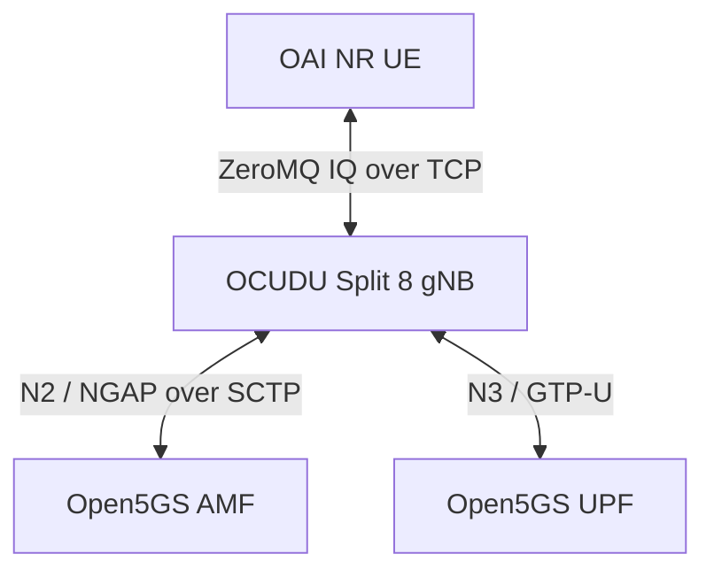
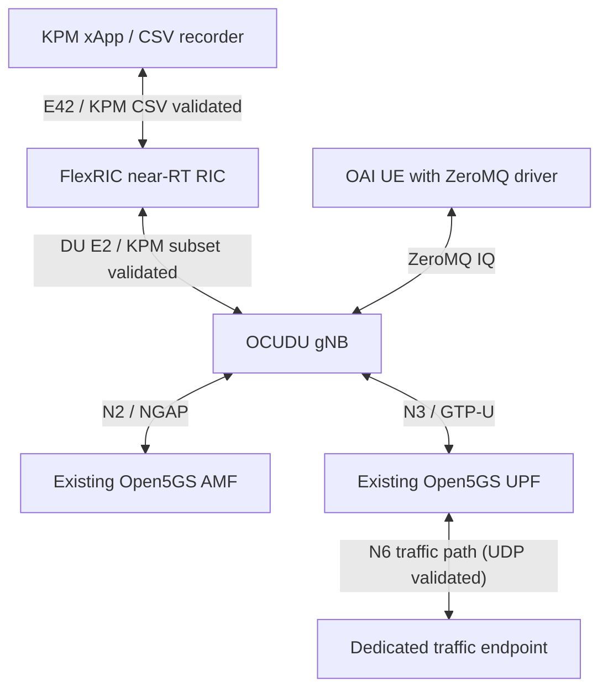

# OCUDU + OAI UE ZeroMQ integration on Raspberry Pi

## Validation status

Validated on a four-core Cortex-A76 ARM64 Raspberry Pi with approximately
8 GiB RAM on 2026-10-14, Pacific time.

The dedicated two-worker OCUDU image passed initial UE attachment and
TUN-bound UPF pings. Three subsequent rounds independently recreated both
experiment containers. Each round passed two sets of five UPF pings and
a 20-second interval with unchanged container process identities and UE
IPv4 address. All 30 regression ping requests received replies.
Both experiment services were stopped after every round.

UE addresses were 192.168.100.26, .27 and .28 across the three rounds.
Address preservation is checked within each round; allocation can change
between fresh sessions.

This validates bounded software-radio connectivity. Separate UDP tests
passed at 1 Mbps for 10 seconds per direction; see the
[UDP validation guide](README.zmq-udp.md). Maximum throughput, long-term
stability, physical RF and AI control remain unvalidated. The bounded
DU E2/KPM and CSV subset subsequently passed single-round and three-round
tests on 2026-10-15, Pacific time; see the
[KPM validation guide](README.zmq-kpm.md). Complete interoperability,
precise one-second reporting and abnormal-disconnection recovery remain
unvalidated.

## Architecture



Open5GS runs on the existing `docker_open5gs_default` network.
The connectivity-only experiment does not require a RIC or xApp.
The E2/KPM experiment adds both through compose.e2.yaml.

### Integrated DU KPM test topology

The bounded DU KPM tests extend the connectivity baseline with FlexRIC,
a KPM xApp / CSV recorder and a dedicated traffic endpoint.



The OAI UE / ZeroMQ / OCUDU / existing Open5GS path has passed bounded
connectivity checks. A dedicated traffic endpoint at 172.22.0.151 and
bounded UDP uplink/downlink tests have also passed. The DU FlexRIC
E2/KPM path, normal subscriptions, CSV recording and normal deletion
passed single-round and three fresh-container rounds. This covers only
the documented subset. Abrupt xApp disconnection exposed an unresolved
RIC cleanup crash; full protocol compatibility is not established.

Start with one gNB and one UE. Run the original OAI RFsim baseline and
the OCUDU ZeroMQ scenario sequentially against the existing core, using
the same traffic definitions for later comparison. Do not run both full
RAN stacks concurrently on the four-core Pi without a resource assessment.
ZeroMQ is a software IQ transport and is not the OAI RFsim protocol.

| Component | Address / setting |
| --- | --- |
| AMF | 172.22.0.10:38412 |
| UPF | 172.22.0.8; UE gateway 192.168.100.1 |
| OCUDU gNB | 172.22.0.160; container CPU set 1-2 |
| OAI UE | 172.22.0.161; container CPU set 3 |
| Downlink IQ | gNB TCP 4558 |
| Uplink IQ | UE TCP 4556 |
| Cell | n78, 20 MHz, 51 PRB, 30 kHz SCS, PCI 1, 1T1R |
| Sample rate | 23.04 Msamples/s |
| Core identity | PLMN 00101, TAC 1, SST 1 |

CPU sets do not reserve exclusive host cores.

## Images and source policy

The passed Compose workflow now defaults to these Docker Hub images.
Both were published and pull-verified on 2026-10-14, Pacific time.
ARM64 architecture, original local image identity and registry digest
were verified.

| Component | Published image |
| --- | --- |
| OAI UE | `limx59/oai-pi-oai-nr-ue:arm64-zmq-test` |
| OCUDU two-worker gNB | `limx59/oai-pi-ocudu-gnb:arm64-zmq-worker-test` |

Published image-index digests:

- OAI UE: `sha256:73fa22bcb85f2c040a398d0c3159a7a9083e7dee7db23a7c6fe7e3c26d2110e8`
- OCUDU gNB: `sha256:1733f139f5e1001ca0c146f8b51e017d9fe71b0c07616beff233b468be8cc608`

Original local tags are retained. The base Compose file's gNB image,
`oai-pi-ocudu-gnb:zmq-test`, is the original diagnostic baseline.
Always include `compose.zmq-worker-test.yaml` for the passed workflow.

Three-round functional regressions passed using both the original local
tags and the updated published Compose references. The published-reference
regression passed all 30 ping requests, process/address stability checks
and automatic stopping across three fresh-container rounds.

OCUDU source revision and license location:
[upstream record](../../docker/ocudu/UPSTREAM.md).

Project Dockerfiles and patches operate on Docker source copies.
The vendored `ocudu/` and existing `oai/` source trees remain unchanged
by this integration work.

## Single-worker failure and diagnostic workaround

The original image connected to AMF and activated cell scheduling, but
the UE failed initial synchronization. An independent ZeroMQ probe
received all-zero downlink IQ over one second of samples. In a separate
actual-UE debug run, all 2365 FAPI records were slot indications, with
no recorded downlink requests.

The upstream worker-count calculation reserves up to three available
CPUs and clamps even explicitly configured counts. On this Pi it produced
one main-pool worker. Non-real-time cell executors also use synchronous
task wrappers.

`Dockerfile.worker-test` changes only the Docker source copy to honor
an explicit worker count within the available CPU count. The deployment
override requests two workers. This configuration produced downlink
FAPI requests, successful PBCH decoding, a PDU session and passing pings.

The comparison strongly implicates the single-worker execution path.
A precise blocked call stack and a general upstream fix have not been
established. This remains a diagnostic workaround, not an upstream fix.

## Prerequisites

- Existing Open5GS services and network running.
- Experiment addresses .160 and .161 available.
- Matching subscriber credentials provisioned in Open5GS.
- Private UE configuration at `deploy/ocudu/.local/ue-zmq.conf`.
  Keep it untracked; `.local/` is ignored. Use directory mode 0700 and
  file mode 0600.
- UE configuration retains the provisioned UICC/PDU-session settings,
  removes the RFsim section and selects `oai_zmqdevif`, with TX endpoint
  `tcp://0.0.0.0:4556` and RX endpoint `tcp://172.22.0.160:4558`.
- `/dev/net/tun` and the OAI single-port UE capability XML available.
- No experiment containers already running before invoking the validator.

Do not commit subscriber keys or private generated configuration.

## Build

Optional local rebuild commands follow. They retain local tags and do not
replace the published Compose defaults. To use locally rebuilt images,
supply an explicit Compose image override.

Run from the project root:

```bash
sudo docker build -f docker/oai/Dockerfile.nrue-zmq \
  --target nrue --build-arg BUILD_JOBS=2 \
  -t oai-pi-oai-nr-ue:zmq-test .

sudo docker build -f docker/ocudu/Dockerfile.worker-test \
  --target gnb --build-arg BUILD_JOBS=2 \
  -t oai-pi-ocudu-gnb:zmq-worker-test .
```

The OCUDU build uses `cortex-a76+crypto` and an ARMv8.2-A fallback.
The worker test Dockerfile reuses the baseline builder stages when cached.

## Test guides

- Connectivity: the run instructions below and `validate-zmq-connectivity.py`.
- [Bounded UDP uplink/downlink validation](README.zmq-udp.md): prerequisites, execution, acceptance, results and cleanup.
- [DU KPM and CSV validation](README.zmq-kpm.md): configuration, bounded UDP load, CSV checks, regression results and known recovery limitations.

## Run validation

Run from the project root. The validator starts the experiment itself;
do not separately start the containers first.

```bash
python3 test/ocudu/validate-zmq-connectivity.py \
  --rounds 1 --output-dir /tmp/ocudu-zmq-connectivity \
  </dev/null
```

Repeatability check:

```bash
python3 test/ocudu/validate-zmq-connectivity.py \
  --rounds 3 --output-dir /tmp/ocudu-zmq-connectivity-regression \
  </dev/null
```

Each round force-recreates gNB and UE, waits up to 60 seconds for the TUN
IPv4 address, pings 192.168.100.1 through `oaitun_ue1`, waits 20 seconds,
checks process/address stability and repeats the pings. It saves filtered
logs and `summary.json`, then stops both services. Failure stops the
regression and retains evidence.

## Cleanup

The validator stops containers but retains them for inspection.
To remove this experiment's containers after evidence collection:

```bash
sudo docker compose \
  -f deploy/ocudu/compose.zmq.yaml \
  -f deploy/ocudu/compose.zmq-worker-test.yaml \
  --profile ue down
```

Check for remaining experiment and IQ-probe containers:

```bash
sudo docker ps -a --format '{{.Names}}' |
  awk '/^oai-pi-ocudu-zmq-lab-/ || /^ocudu-iq-probe-/'
```

For an E2 experiment, follow the cleanup instructions in
[the KPM guide](README.zmq-kpm.md), including the E2 Compose overlay,
before expecting an empty result.

Expected output is empty. Review any leftover probe by name before removing
it. Do not prune unrelated containers, images, networks or volumes.
The shared external Open5GS network and other services are retained.
Restart both ZMQ endpoints together when repeating the experiment.

## Evidence

Initial successful comparison and connectivity archive:

`ocudu-oai-zmq-initial-connectivity-20261014-220909.tar.gz`

Three-round regression:

- Directory: `/tmp/ocudu-zmq-connectivity-regression/run-5px273zy`
- Archive: `ocudu-oai-zmq-connectivity-regression-20261014-221433.tar.gz`

Published-reference three-round regression:

- Directory: `/tmp/ocudu-zmq-dockerhub-connectivity-regression/run-ewtyewbz`
- Archive: `ocudu-oai-zmq-dockerhub-connectivity-regression-20261014-223545.tar.gz`
- UE addresses: 192.168.100.29, .30 and .31 across the three rounds.

DU KPM/CSV single-round, three-round and interrupted-run evidence:

`ocudu-kpm-csv-20261015-214428.tar.gz`

See [DU KPM and CSV validation](README.zmq-kpm.md) for results and limitations.

Docker Hub reference DU KPM/CSV three-round regression passed on
2026-10-16, Pacific time: six directional phases, zero packet loss,
116 CSV rows and normal deletion/cleanup checks passed.

- Directory: `/tmp/ocudu-zmq-dockerhub-kpm-regression/run-jrzfzyab`
- Archive: `ocudu-dockerhub-kpm-regression-20261016-104059.tar.gz`
- Published RIC/xApp references and digests: [KPM guide](README.zmq-kpm.md).

Archives reside under `~/Work/oai-test-evidence/`, outside the repository.
Retain failed-run evidence as well as passed results.

## TODO

Existing OAI/FlexRIC results remain reusable baselines. OCUDU results
are recorded separately: connectivity, bounded UDP and the documented
DU KPM/CSV subset have passed their respective tests. These results do
not establish complete E2 interoperability, precise one-second reporting,
abnormal-disconnection recovery or control support.

| Test case | Completed | Remaining |
| --- | --- | --- |
| Node discovery | ✅ NG Setup and DU E2 Setup; node 420 with DU ID 0 observed | ☐ CU Agent identities; RIC/Agent reconnection; abnormal exit cleanup |
| KPM monitoring | ✅ DU action Format 4 / indication Format 3; idle zero values and positive UL/DL values under bounded load | ☐ One-second wall-clock cadence; units and accuracy; other report styles; missing metrics and unsupported subscriptions |
| KPM CSV recording | ✅ Node/PLMN and UTC receive timestamps; complete finite numeric rows; positive values under directional UDP load; normal subscription deletion guard; single-round and three-round regression | ☐ Actual UE and CU/DU identifiers; measurement units and collection windows; quantitative comparison with traffic results |
| 🔴 RIC disconnect recovery | ✅ Interrupted-run crash evidence retained | ☐ Fix pending-subscription cleanup after abrupt xApp disconnection; verify RIC survival and reconnection |
| QoS monitoring | ✅ Existing policy and alert framework available for reuse | ☐ Map OCUDU throughput, latency and packet-loss fields; bounded high/low-load alerts; restore state after reconnection; advisory mode first |
| MAC / RLC / PDCP statistics | ✅ Differences between standard KPM and existing private service models reviewed | ☐ Verify OCUDU E2/local metric sources; detect duplicates, missing values and counter resets; compare with iperf; verify xApp compatibility |
| Traffic steering policy | ✅ Existing load-exchange and rule-evaluation methods provide a reusable baseline | ☐ Single-link load response; sequential OAI/OCUDU comparison; dual-node recommendations when resources permit; common metrics and cooldown rules |
| Traffic steering control | ✅ Existing OAI RFsim handover feedback loop passed as an OAI baseline | ☐ Audit supported OCUDU RC actions; verify control ACK and execution separately; cross-vendor handover remains exploratory |
| Multi-Agent slicing control | ✅ Existing standalone OAI NR DL scheduler PRB-cap simulation passed as an OAI baseline | ☐ Verify OCUDU slice configuration and control interfaces; offline/startup configuration experiments first; actual grant/counter evidence; verify support before reusing private SLICE commands |
| Energy-saving control | ✅ Existing policy and state-feedback simulation available for reuse | ☐ OCUDU advisory and state simulation; **physical device control and power measurement deferred pending hardware** |
| Integrated regression | ✅ ARM64 OCUDU/OAI UE ZeroMQ builds; connectivity and published-image regressions; [bounded UDP UL/DL](README.zmq-udp.md); [DU KPM/CSV](README.zmq-kpm.md) single-round and three fresh-container rounds; evidence archiving and normal cleanup | ☐ Abnormal-disconnection recovery; longer-session stability; precise report timing; full-workflow regression; **physical RF deferred pending SDR hardware** |

Execution follows the research plan: bounded traffic validation (P5) and
the documented normal-operation DU KPM/CSV subset of P6 passed single
and three-round tests. **🔴 Next: fix RIC cleanup after abrupt xApp
disconnection.** Precise timing, metric accuracy and actual UE identity
remain open. Full-workflow regression (P7), sequential OAI/OCUDU
comparison (P8), and capability-gated RC/slicing experiments (P9) follow.

For P5, retain iperf JSON and receiver-side results. The initial project
acceptance thresholds are received throughput of at least 80% of the
offered load and packet loss no greater than 5%. Record failures without
silently relaxing these thresholds.

Track sustained-session rounds and fresh-container rounds separately.
Retain failed-run evidence as well as successful results.
