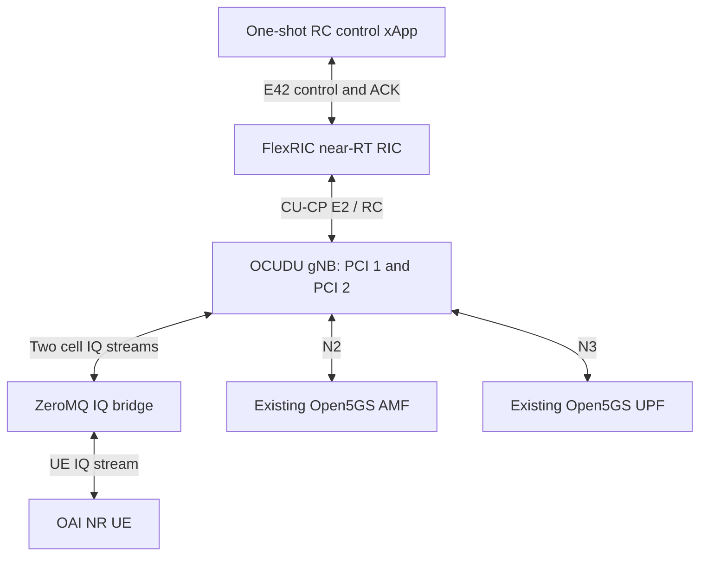

# Traffic steering control: OCUDU RC handover

## Status and scope

**Passed for one UE moving from PCI 1 to PCI 2, with source downlink
muting after receipt of the handover command.**

Three fresh-container rounds passed with the final local images.
A separate regression passed using the published Docker Hub references.
Each run sent one RC control request, correlated its ACK, verified target
handover completion and passed five post-handover UPF pings.

The retained run timestamps are 2026-11-02 UTC
(2026-11-01 Pacific time).

This is an intra-CU, intra-DU two-cell software-radio experiment.
The xApp requests handover; the validator separately mutes the source
downlink through the IQ bridge. Muting is a laboratory action, not an
E2 control action or an autonomous traffic-steering policy decision.

Continuous mixed-cell reception, reverse handover, repeated handovers
within one session, multi-UE behavior, physical RF, radio-frame alignment,
maximum throughput and long-term stability remain unvalidated.
Cross-vendor RAN handover is not established.

## Topology



| Setting | Value |
| --- | --- |
| E2 node | 420; CU-CP E2 enabled, DU/CU-UP E2 disabled |
| RC RAN function | 3 |
| Source cell | PCI 1, sector 0, NCI 107520 |
| Target cell | PCI 2, sector 1, NCI 107521 |
| gNB ID length | 28 bits |
| PLMN | 00101; encoded bytes `00f110` |
| Target CGI | `0000f11000001a4010` |
| Initial DL amplitude gains | Source 0.55, target 0.45 |
| After source mute | Source 0.0, target 0.45 |
| Target PRACH root | 64 |
| Target dedicated DCI | 0_0 / 1_0 |
| Target PDSCH/PUSCH MCS tables | qam64 |
| UPF ping destination | 192.168.100.1 through `oaitun_ue1` |

The bridge continues consuming both cell downlinks after muting and
retains the target gain and sample ordering. Uplink samples are copied
to both cells. Its transport tests do not establish radio-frame alignment.

## Published runtime images

All five resolved services use Docker Hub references pinned by digest.
The validator also checks the tested local image identities.
The Compose workflow uses `pull_policy: never`; pull the images explicitly
before running it.

| Service | Published tag | Digest |
| --- | --- | --- |
| gNB | `limx59/oai-pi-ocudu-gnb:arm64-steering-prb-kpm-metadata-v2-test` | `sha256:8bceed7d42bccddd286a7c6d29e662f0daf788e4c5dc73b8a2ba9b4fb279724b` |
| UE | `limx59/oai-pi-oai-nr-ue:arm64-zmq-dci10-config-selection-test` | `sha256:bbdceed41714844717eaf9a06e09284f5404e27daff870d1f1ec08c782182047` |
| IQ bridge | `limx59/oai-pi-ocudu-zmq-iq-bridge:arm64-source-mute-test` | `sha256:e81707f75606c8a64105ef9c4c27c8fefda67db8f676a304cb59cfd69bc130e2` |
| RIC | `limx59/oai-pi-ocudu-flexric-ric:arm64-rc-control-results-v2-test` | `sha256:18358f2f935e9d3937a1469985b2c10427e170b6f0fa09a7dabfad1fdbb71977` |
| Control xApp | `limx59/oai-pi-ocudu-flexric-xapp:arm64-rc-handover-control-test` | `sha256:a9c7e2add4458b7fbb0b8b15ef371f7fc8a28c46ffe893d7f7078f82a9647a86` |

```bash
sudo docker pull limx59/oai-pi-ocudu-gnb:arm64-steering-prb-kpm-metadata-v2-test@sha256:8bceed7d42bccddd286a7c6d29e662f0daf788e4c5dc73b8a2ba9b4fb279724b
sudo docker pull limx59/oai-pi-oai-nr-ue:arm64-zmq-dci10-config-selection-test@sha256:bbdceed41714844717eaf9a06e09284f5404e27daff870d1f1ec08c782182047
sudo docker pull limx59/oai-pi-ocudu-zmq-iq-bridge:arm64-source-mute-test@sha256:e81707f75606c8a64105ef9c4c27c8fefda67db8f676a304cb59cfd69bc130e2
sudo docker pull limx59/oai-pi-ocudu-flexric-ric:arm64-rc-control-results-v2-test@sha256:18358f2f935e9d3937a1469985b2c10427e170b6f0fa09a7dabfad1fdbb71977
sudo docker pull limx59/oai-pi-ocudu-flexric-xapp:arm64-rc-handover-control-test@sha256:a9c7e2add4458b7fbb0b8b15ef371f7fc8a28c46ffe893d7f7078f82a9647a86
```

## Prerequisites

Use the existing ARM64 Raspberry Pi repository and its provisioned
Open5GS environment. Follow the [baseline prerequisites](README.md#prerequisites),
including the private UE configuration, matching subscriber, TUN device
and UE capability XML. This is not a standalone core deployment.

The existing core services and baseline RIC must be running.
The experiment addresses, including gNB .160, UE .161 and temporary RIC
.163 on `docker_open5gs_default`, must be available.
Stop the original test RAN before running this scenario.
Do not separately start the handover experiment.

Private configuration is generated from the existing baseline and
prerequisite helpers. Keep all referenced project configuration files,
helpers and source-provided UE capability XML available; published runtime
images alone do not replace these repository dependencies.

## Run validation

Run from the repository root:

```bash
python3 -B test/ocudu/validate-rc-handover-dockerhub.py
```

The runner combines these Compose files in order:

1. `deploy/ocudu/compose.rc-two-cell-source-mute.yaml`
2. `deploy/ocudu/compose.rc-handover-control.yaml`
3. `deploy/ocudu/compose.rc-handover-dockerhub.yaml`

It generates private configuration with
`prepare-rc-two-cell-fallback-dci-v2.py`.
The final overlay selects the published runtime images.
The local regression entry point is
`validate-rc-handover-config-selection-v2.py`; use the Docker Hub entry
point above for the published workflow.

The runner prints UTC progress and filtered UE diagnostics.
The complete xApp output is retained in `probe.stdout` and `probe.stderr`.
A failed PBCH attempt before eventual successful target synchronization
does not alone mean the run failed.

## Acceptance and cleanup

The validator checks:

- Initial source attachment and five TUN-bound UPF pings.
- Current-run NGAP/GUAMI and F1AP UE identity extraction.
- Exactly one control request and correlated RIC/xApp ACK evidence.
- Source mute confirmation after ACK validation and observation of
  `reconfigurationWithSync`.
- Ordered UE handover-command, PCI 2 synchronization and successful
  random-access evidence.
- gNB receipt of `rrcReconfigurationComplete` for the same target UE
  whose handover target routine subsequently finishes successfully.
- Five post-handover UPF pings and unchanged test process identities.
- Cleanup and before/after continuity of the core and baseline RIC.

An ACK alone does not establish handover execution.
The acceptance does not require a `phyCellID 1->2` message: the observed
OAI handover path provides target synchronization and RA evidence instead.

The validator creates an isolated Compose project and removes its test
containers in cleanup. It retains evidence and removes the temporary
configuration. Check both `passed` and `cleanup_errors` in `summary.json`.
Do not use broad pruning or remove unrelated core/RIC containers.

## Diagnosed failures and final fixes

### Target synchronization

Unrestricted SSS search selected incorrect PCI candidates during target
resynchronization. The target-PCI patch passes the requested PCI to
`rx_sss_nr`. At source/target gains 0.55/0.45, the UE could identify PCI 2
but repeatedly failed PBCH decoding while both downlinks were mixed.
After source muting, target PBCH decoding and random access succeeded.

This comparison supports source interference as a factor in this setup.
It does not establish a general RF diagnosis or validate continuous
mixed-cell handover.

### DCI 1_0 configuration selection

GDB located the subsequent UE crash in `nr_ue_process_dci_dl_10` in
`openair2/LAYER2/NR_MAC_UE/nr_ue_procedures.c`.
The crash frame showed a null `pdsch_config`, `get_sib1=1`, a non-null
current DL BWP and C-RNTI processing.

Pending target SIB1 acquisition can coexist with dedicated scheduling.
The old code used the pending-SIB1 flag to discard the dedicated PDSCH
configuration for unrelated grants, then dereferenced that null pointer.

The final patch scopes SIB1-dependent decisions to the current
SI-RNTI grant and guards the optional PDSCH pointer.
It preserves target SIB1 reacquisition rather than forcibly clearing
the pending flag. The TDA helper already ignores its SIB1 argument for
C-RNTI; changing that argument is not a separate C-RNTI TDA fix.

The final UE build retains the existing NCC patch, synchronization
diagnostics and target-PCI SSS patch, then applies
`patches/patch-oai-ue-dci10-config-selection.py`.
The earlier null-only diagnostic patch is not stacked onto this build.
Project patches modify Docker build copies, not host third-party sources.

Relevant build definitions:

- `docker/oai/Dockerfile.nrue-zmq-dci10-config-selection`
- `docker/ocudu/Dockerfile.zmq-iq-bridge-source-mute`
- `docker/ocudu/Dockerfile.rc-handover-control`

## Retained results

Evidence directories are under `test/ocudu/.local/evidence/`.

| Run | Directory | Result | Post-handover pings |
| --- | --- | --- | --- |
| Local regression 1 | `ocudu-rc-handover-config-selection-v2-e7qfjp9o` | Passed | 5/5 |
| Local regression 2 | `ocudu-rc-handover-config-selection-v2-9cbg8ass` | Passed | 5/5 |
| Local regression 3 | `ocudu-rc-handover-config-selection-v2-r_ijfvz8` | Passed | 5/5 |
| Published-reference regression | `ocudu-rc-handover-dockerhub-gm028xtl` | Passed | 5/5 |

The three local regression rounds passed 15/15 post-handover pings.
The additional published-reference run passed 5/5.
Each run sent one control request, retained unchanged core/baseline RIC
identities and completed cleanup without errors.

Each directory contains `summary.json`, before/after control logs,
runtime logs, source-mute evidence, xApp output and ping results.
Runtime debug logs can contain subscriber or security material.
Keep private evidence untracked and review/redact it before sharing.
Do not commit private configurations or credentials.
